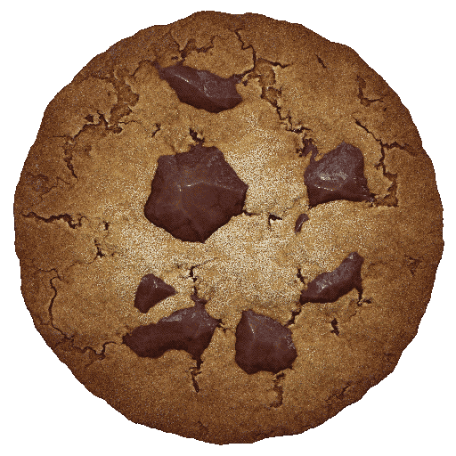

# Cookie Clicker — iOS optimized version



iPhone（Safari / ホーム画面Webアプリ）で快適に遊べるようにした Cookie Clicker です。
[plasma4/cookieclicker](https://github.com/plasma4/cookieclicker)（`88bfa8b`）をベースに、
**ゲームロジック・バランス・セーブ形式には手を入れず**、入力・viewport・PWA・iOS回避策だけを
別レイヤー（`ios-fixes.css` / `ios-fixes.js`）として追加しています。

- **プレイ URL:** https://da1channn.github.io/cookieclicker/
- plasma4 のオリジナル版も同梱: `desktop.html`（通常版）, `mobile.html`, `modded.html`
- 元の README: [README.plasma4.md](README.plasma4.md)

> 非公式ミラーです。ゲームの著作権は Orteil / DashNet にあります。

---

## ホーム画面への追加（iPhone）

1. Safari で https://da1channn.github.io/cookieclicker/ を開く
2. 共有ボタン → **「ホーム画面に追加」**
3. 「Webアプリとして開く」が ON になっていることを確認して追加
4. ホーム画面のクッキーアイコンから起動（Safari の UI なしの全画面で起動します）

**重要: Safari とホーム画面アプリはストレージが別です。** Safari で遊んでいたセーブは
ホーム画面アプリには自動で引き継がれません。Safari 側で *Options → Export save* でコピーし、
ホーム画面アプリで *Options → Import save* に貼り付けてください（plasma4 版・公式ブラウザ版のセーブも同じ手順で読み込めます）。

## 何を直したか

| 症状 | 原因 | 対策 |
|---|---|---|
| ダブルタップでズームする | `width=900` のデスクトップ扱い viewport でズーム可能なページだった。WebKit は `position:absolute` の子孫に `touch-action` が効かないことがある（[#218015](https://bugs.webkit.org/show_bug.cgi?id=218015)） | `width=device-width` + `user-scalable=no` + `min/max-scale=1`、全要素に `touch-action`、クッキーは `touchstart` を `preventDefault`、`gesture*` / 2本指 `touchmove` をブロック |
| 連打が微妙に遅れる・まとめて反応 | `click` 待ち（ダブルタップ判定）。さらに効果音が毎回 `<audio>.src` 再設定で Safari が再読込・再デコードしていた | `pointerup` で即 `Game.ClickCookie()`、ネイティブ click は抑止。効果音は Web Audio（デコード済みバッファ） |
| 連打の取りこぼし | 2本指で交互に叩くと iOS は click を出さない | ポインタごとに判定するので2本指ドラミングも全カウント |
| 建物購入が1回目でツールチップだけになる／二重購入の不安 | iOS のホバー判定（mouseover で内容が変わると click を出さない） | 建物・アップグレード・ゴールデンクッキーも `pointerup`（ゴールデンは `pointerdown`）で1回だけ実行、ゴーストクリックは捕捉して破棄 |
| 拡大縮小・回転後に位置がずれる | ページズーム状態、キーボード後のスクロール残り、回転直後の古い `innerWidth`、iOS standalone の復帰バグ（[#301172](https://bugs.webkit.org/show_bug.cgi?id=301172) 等） | ズーム自体を禁止。回転/復帰/キーボード後に viewport を検査し、**異常か寸法変化があった時だけ** `Game.resize()`（常時リサイズ・reload はしない） |
| タップ位置と演出の位置がずれる | 本体の座標計算 `(pageY-32)/scale` が scale≠1 で約33px ずれる | `#wrapper` 基準で正しく換算（`getBounds` も同じ基準に） |
| Dynamic Island / ホームインジケータと重なる | — | `viewport-fit=cover` + `env(safe-area-inset-*)` の内側にゲームを配置 |
| バックグラウンドで iOS に落とされると最大60秒分の進行が消える | iOS は停止中の Webアプリを unload なしで終了する | 非表示になった瞬間に通常のオートセーブと同じ条件で保存 |
| 音楽アプリの再生が止まる | `<audio>` が他アプリの再生を止める | `navigator.audioSession.type = 'ambient'`（他アプリの音楽とミックス、消音スイッチに従う） |
| オフラインで起動できない | — | Service Worker（コードは network-first、画像・音は使ったものだけ cache-first） |

### ダブルタップズーム対策（P0）

1. viewport: `width=device-width, initial-scale=1, minimum-scale=1, maximum-scale=1, user-scalable=no, viewport-fit=cover`
   → WebKit は非スケーラブル viewport ではダブルタップ判定をせず即座にタップを dispatch します。
2. CSS: `html, body { touch-action: manipulation }` に加え、`.ios-fixes * { touch-action: manipulation }`
   （WebKit が absolute 子孫に継承しないケース対策）。クッキー/左パネル/ゴールデンクッキー/昇天画面/パンテオンの神は `none`、
   ストア・中央パネルなどスクロール領域は `pan-y`（ダブルタップもピンチも不可、縦スクロールのみ）。
3. JS: クッキーの `touchstart` を `preventDefault`（その指ではブラウザ側ジェスチャーが一切始まらない）、
   `gesturestart/change/end` と2本指 `touchmove` を `preventDefault`（Safari の「拡大縮小を常に許可」等で viewport 制限が無視されても防ぐ）、`dblclick` も破棄。

### タップ遅延対策（P0）

- `pointerdown` で記録 → `pointerup` で「動いていない(10px以内)・500ms以内・指がまだ同じ要素上」なら即実行。
  - クッキー: `Game.ClickCookie()` を**イベントなしで**呼ぶ（`PointerEvent.detail` は 0 で、本体はそれを 3回/秒に制限するため。マウスと同じ 50回/秒の上限になる）。
  - 建物・アップグレード: 要素の `click()` を1回だけ実行（本体のハンドラをそのまま使う）。
  - ゴールデンクッキー: 指が触れた瞬間（`pointerdown`）にポップ。
- 同じタッチの `touchend` を `preventDefault` してブラウザの互換マウスイベントと click を止め、それでも届いた信頼済み click は 800ms 以内なら capture で破棄（＝二重実行しない）。
- マウス / トラックパッド（`pointerType !== 'touch'`）は従来どおりネイティブ click。Pointer Events 非対応環境では何もしない。
- 長押し（500ms超）は購入せずツールチップ表示だけ。指を滑らせて離すとキャンセル。他の場所に触れるとツールチップを閉じる。
- 効果音: `PlaySound` を同じ引数・同じ音量カーブの Web Audio 版に差し替え（最初に使う音は事前デコード、失敗時は元の実装にフォールバック）。
- 計測: `?iosdebug=1` を付けると `pointerdown`/`pointerup`/`ClickCookie` のタイムスタンプと遅延を console に出します（通常は無効）。

### viewport の設計（P1）

案A〜Dを比較し、**案D（= 案B）: device-width viewport + 本体の既存スケーリングを利用** を採用しました。

| 案 | 内容 | 評価 |
|---|---|---|
| A | device-width + 全体に `transform: scale()` を新規実装 | 本体の座標計算（`Game.scale`, `getBounds`）と二重になり破綻 |
| B | 固定論理幅コンテナだけ scale | 本体の `Game.resize()` が既に `#wrapper` に対してこれを実装済み |
| C | CSS `zoom` | Safari では座標系・`getBoundingClientRect` の扱いが Chromium と異なり、本体のマウス計算と整合しない |
| **D** | **device-width viewport 上で、本体の `Game.resize()`（論理幅 最小800px → `#wrapper` を `scale`）をそのまま使い、safe area 分だけ補正** | **採用**。ページ自体は常に倍率1で絶対にズームしない／回転時も本体の計算で再配置 |

- 縦向き（393pt幅の場合）: 論理 800px 幅を `scale≈0.49` で表示（plasma4 の `width=900` 時の 0.44 より少し大きい）。
- 横向き: 幅が800以上なら等倍。safe area（左右のノッチ）を除いた範囲に収める。
- `Game.resize()` の後処理として safe area 内に `#wrapper` を移動し、同じ式で `scale` を再計算、canvas のリサイズコールバックも再実行。

### PWA / GitHub Pages（P1）

- `manifest.webmanifest`（`start_url`/`scope` は相対 `./`、`display: standalone`）、`apple-touch-icon`、
  `apple-mobile-web-app-capable`、`black-translucent` ステータスバー。
- すべて相対パス。`/cookieclicker/` サブパスで 404 が出ないことを eval で確認。
- `sw.js`: コード（html/js/css/loc）は network-first（更新がすぐ反映）、`img/` `snd/` `fonts/` は使った分だけ cache-first。
  初回起動で読み込んだ素材も SW に渡すので、2回目以降はオフラインでも起動します。セーブ（localStorage）には触れません。

### セーブ互換性（P0）

- セーブ形式・`localStorage` キー（`CookieClickerGame`）は変更なし。
- この版 ⇄ plasma4 `mobile.html` ⇄ `desktop.html` で Export/Import が双方向に通り、同じセーブから同じ Export 文字列が出ることを eval（T19）で確認。
- 追加で使う localStorage キーは設定用の `CookieClickerIOSFixes` だけ（任意）。

## 変更ファイル

| ファイル | 内容 |
|---|---|
| `index.html` | plasma4 `mobile.html` のコピー + viewport / PWA meta / `ios-fixes.*` 読み込み / `IOS_OPTIMIZED=1` |
| `main.js` | **1行のみ**: `mobileFeaturesEnabled` を `IOS_OPTIMIZED` でも有効化（ルートURLで plasma4 のモバイル機能を使うため） |
| `ios-fixes.css` | touch-action / tap highlight / callout / overscroll / スクロール領域 |
| `ios-fixes.js` | fast tap、ズーム防止、safe area レイアウト、座標補正、viewport 自己修復、Web Audio、バックグラウンド保存、SW 登録 |
| `manifest.webmanifest`, `sw.js`, `img/ios/*` | PWA |
| `desktop.html` | plasma4 の `index.html`（内容は未変更、名前のみ変更） |
| `evals/` | iPhone eval スイートと結果 |

## Evals

`evals/run.js` が 34 項目の自動評価を行います（Chromium の iPhone エミュレーション + 実タッチ入力）。
方法と各項目は [evals/README.md](evals/README.md)、スコアの推移は [evals/RESULTS.md](evals/RESULTS.md)。

```sh
NODE_PATH=$(npm root -g) node evals/run.js --target index.html  --label candidate
NODE_PATH=$(npm root -g) node evals/run.js --target mobile.html --label baseline
```

## iPhone 実機で確認すべき項目

Safari と **ホーム画面Webアプリの両方**で:

1. 中央クッキーを高速20連打 → ズームしない／取りこぼさない／遅れてまとめて反応しない
2. ストアの建物を高速タップ → ズームしない、タップ数どおり購入
3. アップグレード購入 → 1タップで1回
4. ストア・中央パネルの上下スクロール → 正常、スクロール中に購入されない
5. 昇天画面 → ドラッグでパン
6. パンテオン → 神をタップ → スロットをタップで配置
7. 菜園 → 種を選んでタイルをタップ
8. 縦 → 横 → 縦 → UI 位置が大きくずれない、ノッチ/Dynamic Island と重ならない
9. ピンチ → ズームしない
10. ダブルタップ（クッキー・ストア・空白部分） → ズームしない
11. ホームに戻って数秒後に復帰 → viewport が変にならない
12. ロック → 復帰 → レイアウト崩れなし
13. ホーム画面から起動 → Safari の UI が出ない
14. 2本指で交互にクッキーを叩く → 全部カウント
15. 建物を長押し → ツールチップだけ出て購入されない
16. Options → Import save でテキスト欄を長押し → 「ペースト」が出る
17. 音楽アプリ再生中に起動 → 音楽が止まらない（効果音は消音スイッチに従う）
18. 機内モードでホーム画面から起動 → ゲームが起動する（一度オンラインで起動した後）

## 既知の制約

- 縦向きは論理幅 800px を縮小表示するため文字が小さい（本体 UI がデスクトップ前提のため。UI 再設計は今回の範囲外）。
- ズームを完全禁止しているので、拡大が必要な場合は iOS の「ズーム機能」（アクセシビリティ）を使ってください。
- Safari とホーム画面アプリのセーブは別保存（iOS の仕様）。
- 効果音は消音スイッチ ON で鳴りません（`ambient` セッション。他アプリの音楽を止めないための選択）。
- `pointerup` 駆動のため、Pointer Events の無い古い iOS（12 以前）では従来どおりの click 動作になります。
- 自動 eval は Chromium で行っており、WebKit 固有の 350ms 判定や standalone 復帰バグそのものは再現できません（構造的チェック + 実機チェックリストで補完）。
- 本体の `Game.mobile` は 0 のまま（plasma4 mobile と同じ）。リーダーボード等「公式の遊び方」ではありません。

## 問題が残った場合に次に試すこと

- 一部機能を切って原因を切り分け: `?iosoff=fastTap` / `?iosoff=audio` / `?iosoff=zoomGuard,layout`（カンマ区切り）。
  恒久的に切るには `localStorage.CookieClickerIOSFixes = '{"audio":false}'`。
- `?iosdebug=1` で入力遅延・リサイズ・viewport 修復のログを確認（`IOSFixes.debugLog`, `IOSFixes.stats`）。
- それでもダブルタップズームが出る場合: ストアにも `touch-action: none` を当て、スクロールを自前実装（慣性スクロールは失われる）。
- 復帰後のレイアウト崩れが残る場合: `visibilitychange` 時の検査条件を広げる（`screen.width` との比較など）、最後の手段として異常検出時のみ `location.reload()`（直前に保存）。
- 縦向きの文字が小さすぎる場合: 縦向き専用レイアウト（左パネルを上に積む等）を `ios-fixes.css` で追加する。

## plasma4 からの差分まとめ

- 追加: `ios-fixes.css`, `ios-fixes.js`, `manifest.webmanifest`, `sw.js`, `img/ios/*`, `evals/*`, `README.plasma4.md`
- 変更: `index.html`（= `mobile.html` + head 部の追加のみ）, `main.js`（1行）, `README.md`
- 名前変更: `index.html` → `desktop.html`
- ゲームロジック・セーブ形式・画像/音/翻訳ファイル: 変更なし
